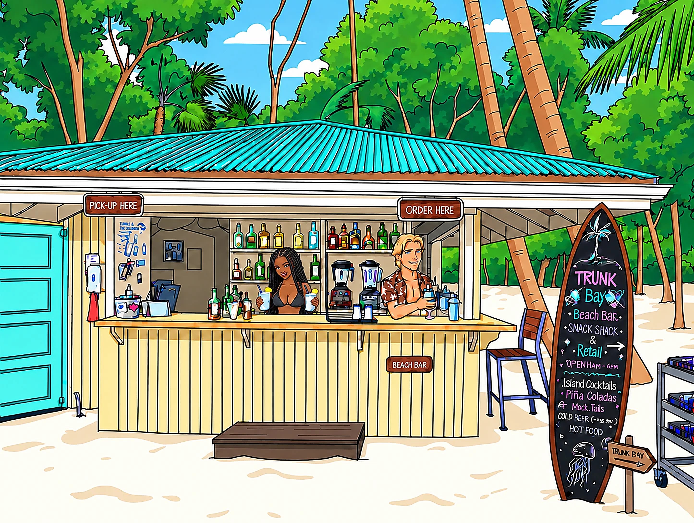

# What you get

Moorings is a free, native menu bar app for macOS 14 or later, signed and notarized. Everything
here works on any display unless it says ultrawide. The [README](README.md) has the details for
each part.

## Window actions on every display

- A full keymap out of the box: left and right halves that cycle through 1/2, 2/3 and 1/3,
  quarters, thirds, two thirds, maximize, maximize height, center, larger, smaller, restore, and
  previous and next display. Other presets are one menu choice away, and None starts from a blank slate.
- Arrow mode: four arrow actions that read where the window is. Left and right take a half, then
  step across quarters and on to the next display. Up maximizes a free window or moves a half or
  quarter up a step. Down restores a maximized window, steps a half or quarter down, or minimizes
  a free one. The Windows keymap puts them on Control-Option arrows.
- Fill left and fill right grow the window sideways to the next window or the edge of the area,
  keeping its far edge.
- Front app windows: bring the next or previous window forward, minimize or close the front
  window, and minimize or close every other window of the app while anchored windows stay put.
- Display one to nine, and a specified size of 1680 by 1050 points that you can change.
- Larger, smaller, double and halve on one axis, each toward the edge you pick.
- Fourths, sixths, eighths, ninths, twelfths, sixteenths, vertical thirds, sixths and eighths,
  corner thirds, almost maximize and center prominently in the Window folder, each ready for a
  key of your choice.
- Your own sizes, as shares of the screen, each with its own shortcut.
- A gap around and between the windows an action places.
- Any action from a link such as `moorings://action?name=left-half`, so a script, a launcher or a
  Stream Deck can run it.
- Any action from Shortcuts: Run Moorings Action takes an action name and offers the list, so a
  shortcut, Spotlight or Siri can run it.
- Extra mouse buttons bound to actions.
- Clicks on the red, yellow and green buttons, plain or with Shift, Option or Command, bound to
  actions. Unbound clicks keep the button's own behavior.
- Shortcuts that switch off while an app you name is in front.
- Behavior choices: repeat presses that cycle sizes,
  traverse or cycle displays, cycle quadrants or switch sides, screen edge gaps, room for the
  Stage Manager strip, Enhanced UI handling, a cursor that follows the window, a hidden menu bar
  icon, display ordering, maximize again to restore, center half cycling, halves that keep the
  other axis, and the smallest size a window shrinks to.
- An experimental switch that slides windows into place instead of jumping, off by default.
- Unsnap restore: dragging a placed window away gives it its earlier size back.
- Double-click a title bar to maximize or restore, with apps you name left alone.
- Chains: a named list of actions that runs one step per press on the same window, stopping on
  the last step or looping back to the first, with its own shortcut, mouse button and menu entry.
- The Moorings menu under the pointer, from a shortcut or a mouse button, without bringing
  Moorings to the front.
- Throw with a held key: pick Right Option, Right Command, Right Control or Fn in Settings >
  Behavior, hold it and move the pointer. A short move toward a side or corner picks a half or a
  quarter, a longer one picks thirds, sixths, maximize or center, and a footprint shows where the
  window will land. Letting go sends the window that was under the pointer there, focused or not.
  Arrow keys switch to a grid of cells instead, Shift-arrows grow the pick, and Return applies it.
  Off until you pick a key.
- The grid: the Grid action lays a grid of cells over the front window's area. Drag across the
  cells you want and let go, or click one cell, and the window fills them. Arrow keys and Return
  work too, and Escape or a click off the grid puts it away. Grid takes the size set in Settings >
  Behavior, and an action named like grid:8x6 has its own.
- Move and resize by hovering: pick the keys in Settings > Behavior, hold them and move the
  pointer, no click needed. The window under the pointer follows it, or with the resize keys it
  grows and shrinks from its nearest corner. Off until you pick keys. Anchored windows stay put.
- Shared edge resize: pick the keys in Settings > Behavior, hold them and drag the edge two side by
  side windows share, and both resize as one divider. Off until you pick keys.
- Undo move and Redo move step a window back through its last ten moves by moorings and forward
  again, each window on its own.
- Quick positions: move the front window to an edge, a corner or the center without resizing it.
- Stash: park a window at the left, right or bottom edge with a sliver showing, by the Stash
  action or by dragging it to the edge with Command held. Rest the pointer on the sliver and it
  slides out, move away and it slides back. Clicking it, or Stash again, ends the stash, and
  Unstash all brings every parked window back. An edge another display touches is skipped, and on
  the ultrawide a side with anchored apps is too. Parked windows go back when Moorings quits.

## Snap by dragging

- Drag a window to an edge or corner, see a footprint of where it lands, and let go to snap it.
- On the ultrawide, the strips stand in for the screen edges, and holding Option while dropping a
  window on a strip anchors its app there.
- Settings > Snapping picks the action for each edge and corner, separately for landscape and
  portrait displays, turns areas off, names keys that must be held to snap, and sets the edge
  margins and corner sizes. The strips on the ultrawide keep their own zones.
- The footprint's fill opacity, border width, color, fade and fade time are yours to set, and a
  haptic tap can mark each new zone.
- Custom areas: any part of a display, as shares from 0 to 1, mapped to any action or size of
  your own. They come before the edges, off the ultrawide.
- The snap panel: pause for a moment while dragging and a row of targets appears above the
  pointer, each drawn as the part of the screen it fills. Drop the window on one to apply it.
  Pick and order the targets in Settings > Snapping. Off until you turn it on.

## Organize

- Tile columns, tile rows, tile all or one app, cascade all or one app, cycle stacked windows,
  and reverse.
- An optional badge counts the windows stacked at a corner when the pointer rests there, and
  cycle stacked windows walks the same windows.
- Tidy channel lines up the two or three front windows, and Undo tidy puts everything back.
- Tiling keeps the free windows of each display in a tall, wide, columns, rows or BSP layout
  as windows open and close, in the channel on the ultrawide. A window you drag floats until you
  choose a layout again. Grow or shrink the main window, and focus or swap the window to the
  left, right, above or below, with tiling on or off.

## Workspaces

- Save the slots, widths, heights and the frame of every free window on every display under a
  name, then recall it from the menu, a shortcut or a link.
- Tie a workspace to a set of displays, and plugging into that setup recalls it. Mark one to come
  back on any display change.
- Open missing apps: a recall opens the apps a workspace names that are not running, with the file
  or URL an imported settings file names, and places their windows once they show.
- App rules: name an app and an action, and its first window goes there when it appears.
- Profiles: save shortcuts, snapping, behavior, chains and menu under a name with a group of
  workspaces, and switch between them from the menu or a shortcut. Anchored apps stay put.

## Anchored apps on an ultrawide

- Up to four apps held at the screen edges, a top and bottom slot on each side, with the open
  middle, the channel, left for everything else.
- Nothing is anchored until you choose an app, so a first start moves no window. On an ultrawide,
  one message says how to anchor the first app.
- Anchor *app* at the top of the menu holds the app you were just using.
- Width and height presets, with a label that says how wide the channel is. Widths holds a
  Presets folder with the built-ins and your own saved pairs. Heights keeps its taller and shorter
  items and per-side presets.
- Adjust strips opens an on-screen editor over the ultrawide. Drag each strip edge or row line,
  use the arrows or type a percent. Arrow keys step 1 percent and Shift steps 5. Tab moves between
  fields, Return keeps the changes and Escape puts back the widths and heights from when it opened.
  The arrows, Return and Escape reach it whichever app is in front, and go back when it closes.
  Windows move live. Typed values clamp so a strip never goes below its app's minimum and the
  channel keeps its minimum share. It is also a bindable shortcut action, adjust-strips.
- Settings, Layout, has a Strips section with number fields for left width, right width and each
  side's top row.
- Click an anchored window's green button to lift it over the channel at full height, and click
  again to lower it.
- Drag an anchored window away and Moorings lets it go, with a message that says how to bring it
  back.
- An app with a minimum width keeps it, and its strip grows to fit.
- Anchored apps that are not running open in the background at launch.
- A side with nothing anchored gives its space to the channel.

## The channel

- A free window that strays into a strip is pushed back. One that is too wide is narrowed and
  grows back when the channel widens.
- Cast off this window lets one window cover the strips, even an anchored app, until it closes
  or you click again.
- A free window's green button fills the channel, and a second click puts it back. Native
  fullscreen fills the channel instead of covering the anchored apps. Each kind of window has its
  own switch.

## Settings window

- Record shortcuts, edit custom sizes, manage workspaces, bind mouse buttons, and pick the keymap,
  snapping, gap and fullscreen handling.
- A Behavior tab for repeat presses, minimum sizes, edge gaps, the pointer, the title bar and
  display order.
- A Menu tab to pin actions to the top of the Window folder, hide the ones you never use, and
  build chains.
- Export every choice to one JSON file and import it on another Mac.
- Restore defaults resets shortcuts, snapping and behavior, and keeps your anchored
  apps, sizes and workspaces.

## Out of sight

- One sailboat in the menu bar and no Dock icon.
- Messages appear in a banner at the top right, not in macOS notifications, so there is no
  notification permission to grant.
- Quit Moorings from the menu and an octopus pulls the sailboat under the water. With Reduce
  Motion on it just quits.
- Launch at login is one menu switch. Opening Moorings while it runs shows the settings window.
- Moorings checks for a new release every six hours, and when the menu opens an hour after the
  last check, and offers it at the top of the menu. The offer opens the release page, and
  Homebrew or the dmg installs it. Nothing installs on its own.
- Installs with `brew install --cask dcadolph/tap/moorings`, or from the signed and notarized dmg
  on each release.
- `moorings://selftest` checks the layout against real TextEdit windows, then puts your slots back.
- `moorings://selftest?apps=<bundle ids>` checks move, resize, snap and restore on other apps' windows.
  A resize the app holds at its own minimum size reads MIN instead of FAIL.
- The layout is checked when a window opens, closes or moves, when an app launches or hides, and
  when displays change. No layout timer runs while nothing moves.
- Nothing moves while the mouse button is down, and a window that keeps fighting its place is
  left alone for a minute.
- Without Accessibility access, a warning sign and one banner lead to the right settings page.
- Tip the harbormaster, below a separator just above Quit Moorings, opens the GitHub Sponsors
  page. Nothing asks for a tip.

## Coming from Rectangle

- Settings > General > Import from Rectangle brings over shortcuts, gaps, snapping and behavior
  choices, and asks before it applies them.
- The default keymap matches the old one.
- Links and scripts keep the same action names and need the `moorings://action?name=<action>`
  URL.
- [COMPARISON.md](COMPARISON.md) lists every feature with the check behind it.

Last call

You found the bar. It also serves the site's 404 page.

