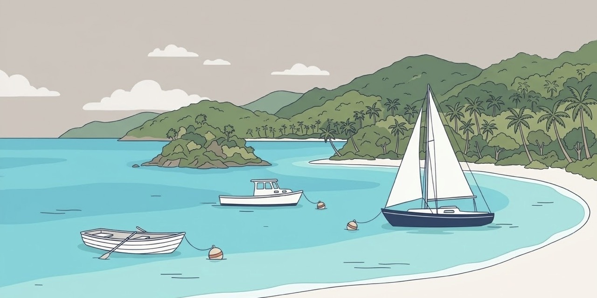

<p align="center">
  
</p>

<h1 align="center">moorings</h1>

<p align="center">
  <a href="https://macmoorings.com"></a>
</p>

<p align="center">
  <a href="LICENSE"></a>
  
  
</p>

A free window manager for every Mac. Snap windows with a key or a drag, and on an ultrawide, pin
your always-on apps to the edges.

A native menu bar app, signed and notarized, with Rectangle's keymap, drag snapping, tiling and
saved layouts on every display, and up to four apps parked on the edges of an ultrawide.
[FEATURES.md](FEATURES.md) lists everything you get.

## How moorings started

There are some windows I don't want to have to find. I just want them to be right there on the
screen, ready to go, no matter how much jumping around I'm doing in other apps or windows.

With a standard sized monitor, apps like Rectangle deliver everything you could reasonably want.
You only have enough space to anchor or park a persistent window, so the fact that Rectangle's
Todo mode only locks down one specified app or window is logical.

For an ultrawide user, the goal posts shift a bit. You still want Rectangle features like
setting your window widths, organizing your windows, snap shortcuts, and more. However, a single
Todo zone just doesn't cut it. For many people optimizing what they have on screen, both sides
of the ultrawide typically need to be parked apps or they go to waste.

Long story short, I created moorings because I wanted for free what Rectangle wanted to charge
me, I wanted more flexibility, and I wanted the customization and the ability to tailor things
to my ultrawide way of working.

## Contents

- [How moorings started](#how-moorings-started)
- [Requirements](#requirements)
- [Install](#install)
- [Quickstart](#quickstart)
- [Docs](#docs)
- [Moving from the Hammerspoon version](#moving-from-the-hammerspoon-version)
- [Support](#support)
- [License](#license)

## Requirements

- macOS 14 Sonoma or later, on Apple silicon or Intel
- Accessibility permission for Moorings
- Rectangle quit, since both apps move windows

## Install

With Homebrew:

```sh
brew install --cask dcadolph/tap/moorings
```

Or download `moorings_vX.Y.Z_macos_universal.dmg` from the
[latest release](https://github.com/dcadolph/moorings/releases/latest), open it, and
double-click Moorings. After one okay it copies itself into Applications, starts from there,
ejects the disk image, and moves it to the Trash. Dragging Moorings onto Applications works too,
and then it asks once before trashing the disk image. The zip is still attached for scripts and
Homebrew. Both are signed with a Developer ID
and notarized by Apple, and `SHA256SUMS` on the release lists their checksums.

Open Moorings. A small sailboat appears in the menu bar. The first time, a banner asks for
Accessibility access: click it, turn on Moorings in Privacy & Security, and the sailboat is
ready. Until then the sailboat shows a warning sign and the menu's first entry opens the same
settings page. Nothing needs a restart after the grant.

To update, take the offer at the top of the menu, or run `brew upgrade --cask moorings`. To
uninstall, quit Moorings and run `brew uninstall --cask moorings`, or drag it to the Trash.

## Quickstart

1. Click the app you want on an edge, open the Moorings menu, choose **Anchor** *app*, and pick a
   slot. Its window moves to that edge and stays there.
2. Press Control-Option-Left in any other window. It takes the left half of the channel, the
   open middle of the ultrawide, or of the whole screen on any other display. Press again for two
   thirds and one third.
3. Drag a window to a screen edge. A footprint shows where it lands. Let go to snap it.
4. Click an anchored window's green button to lift it over the channel. Click again to lower it.

## Docs

How Moorings compares with every other Mac window manager, row by row with a check for each: [COMPARISON.md](COMPARISON.md).

### Menu

The menu rebuilds each time it opens. From the top: an update offer when one is waiting, the
anchor toggle (Weigh anchor lets windows drift, Drop anchor holds them again), Re-moor now,
Anchor or Unanchor the front app, Cast off this window, a Re-moor entry for each released app,
then the Anchored apps, Window, Lift, Workspaces, Widths and Heights folders, Settings, Launch
at login, Check for updates, Tip the harbormaster, and Quit.

### Window actions

Every action works on the front window. On the ultrawide it works inside the channel, and on any
other display inside the usable screen. Halves, quarters and thirds cycle through 1/2, 2/3 and
1/3 on repeat presses. The Window folder lists every action with its shortcut, so it doubles as a
cheat sheet. The default keymap is Rectangle's:

| Action&nbsp;              | Shortcut&nbsp;  | In plain English&nbsp;                           |
|---------------------------|-----------------|--------------------------------------------------|
| Left, right half          | ⌃⌥← ⌃⌥→         | Control + Option + Left Arrow or Right Arrow     |
| Top, bottom half          | ⌃⌥↑ ⌃⌥↓         | Control + Option + Up Arrow or Down Arrow        |
| Quarters                  | ⌃⌥U ⌃⌥I ⌃⌥J ⌃⌥K | Control + Option + U, I, J or K                  |
| First, center, last third | ⌃⌥D ⌃⌥F ⌃⌥G     | Control + Option + D, F or G                     |
| Two thirds                | ⌃⌥E ⌃⌥R ⌃⌥T     | Control + Option + E, R or T                     |
| Maximize                  | ⌃⌥↩             | Control + Option + Return                        |
| Maximize height           | ⌃⌥⇧↑            | Control + Option + Shift + Up Arrow              |
| Center                    | ⌃⌥C             | Control + Option + C                             |
| Larger, smaller           | ⌃⌥= ⌃⌥-         | Control + Option + Equals or Minus               |
| Restore                   | ⌃⌥⌫             | Control + Option + Delete                        |
| Previous, next display    | ⌃⌥⌘← ⌃⌥⌘→       | Control + Option + Command + Left or Right Arrow |

Window > Keymap switches to Spectacle's set. Fourths, sixths, eighths, ninths, twelfths,
sixteenths, vertical thirds, sixths and eighths, corner thirds, almost maximize, center
prominently and the move actions have no key until you record one in Settings.

Every other Rectangle action is here under Rectangle's name, so its links and scripts carry
over. Window > Displays sends the front window to display one through nine, counted left to
right with a row of displays above another counted first. Specified sizes it to 1680 by 1050
points unless you change it, centered and shrunk to fit. Window > One axis
makes it wider, narrower, taller or shorter in 30 point steps, or doubles or halves one side
toward the edge you pick. The side names such as `left-side` and `center-section` are aliases of
the halves, as in Rectangle. On an anchored window, Maximize lifts it and Restore puts it back in its slot. Window >
Ignore shortcuts in *app* turns the shortcuts off while that app is in front, so its own keys
work.

### Links

Scripts, launchers and Stream Decks can drive Moorings with links:

```sh
open "moorings://action?name=left-half"
open "moorings://workspace?name=Desk"
open "moorings://settings"
open "moorings://banner?text=hello"
open "moorings://status"
open "moorings://selftest"
```

`status` writes the screens, slots and every window Moorings sees to the unified log under the
`com.dcadolph.moorings` subsystem.

### Custom sizes, gap and mouse buttons

Settings > Sizes adds sizes as shares of the area: x and y place the top left corner, w and h set
the size, from 0 to 1. Each size can take a shortcut and shows in Window > Custom sizes. Window >
Gap leaves 4 to 16 points around each window an action places, and Settings > Layout sets any gap
up to 100. Settings > Layout > Mouse buttons binds the middle, back and forward buttons to any
action.

### Behavior choices

Rectangle keeps its finer behaviors as hidden preferences. Moorings keeps them under `settings.behavior`
in the JSON file Settings exports, at Rectangle's defaults. Edit the file and import it again.

- `subsequentExecution`: what pressing the same shortcut again does. `cycle-sizes` (the default)
  steps a half through 1/2, 2/3 and 1/3. `traverse-displays` sends a left or right half on to the
  next display, and `traverse-and-cycle` does that until it would wrap, then cycles sizes.
  `cycle-displays` places the same action on the next display, `cycle-quadrants` steps a corner
  across the four quarters, `switch-sides` flips a half to the other side, and `none` stays put.
- `screenEdgeGapTop`, `screenEdgeGapBottom`, `screenEdgeGapLeft`, `screenEdgeGapRight` and
  `screenEdgeGapTopNotch` keep points free at the screen edges. `gapsOnMainOnly` limits them to the
  main display and `applyGapsToMaximize` set to false lets maximize ignore them.
- `stageSize` is the width the Stage Manager strip takes when it shows, and
  `alwaysAccountForStage` keeps it free even when it does not. On the ultrawide the strip only
  comes off a channel that reaches the screen edge.
- `enhancedUI` turns an app's Enhanced UI off while an action or a drag snap moves its window, so
  apps such as Slack land on the exact frame. `automatic` (the default) turns it back on afterward except in Chromium
  browsers.
- `moveCursor` moves the pointer to the middle of a window that a shortcut, the menu or a link
  moved.
- `unsnapRestore` (on by default) gives a window that a shortcut, the menu or a drag snap placed
  its earlier size back as soon as you drag it away, with the window kept under the pointer.
- `doubleClickTitleBar` (off by default) maximizes a window when you double-click its title bar,
  and restores it when the window still sits where that maximize put it. It works only when System
  Settings > Desktop & Dock > Double-click a window's title bar is set to Do Nothing, so macOS and
  Moorings never both act. `doubleClickIgnoredApps` lists bundle ids it leaves alone.
- `hideMenuBarIcon` hides the icon. Open Moorings again to reach Settings.
- `screensOrderedByX` orders displays for the display actions: `y-then-min-x` (the default),
  `min-x` or `mid-x`.
- `specifiedWidth` and `specifiedHeight` set the Specified size in points.

### Organize

Window > Organize tiles the free windows on the front window's display in columns, rows or a
grid, tiles one app's windows in a grid, cascades them all or one app's, cycles windows stacked on the same frame, and mirrors them
left to right. Tidy channel lines up the two or three front windows side by side. Undo tidy puts
back every window a fill, tidy or action moved.

### Workspaces

Workspaces > Save workspace stores the slots, widths, heights and the frame of every free window
under a name. Recall puts it back, matching windows by app and title. Recall with these displays
ties a workspace to the displays attached now, and plugging into that set recalls it.

### Settings window

Open it from the menu, or open Moorings again while it runs. It records shortcuts, edits custom
sizes, renames and ties workspaces, picks the keymap, snap areas, gap, mouse buttons, fullscreen
handling and theme, and exports or imports every choice as one JSON file. Imported workspaces
come back untied, since the file may come from another desk. Restore defaults, under the tabs,
asks once and then puts shortcuts, snapping, appearance and behavior back to their defaults.
Anchored apps, strip sizes, ignored apps, custom sizes and workspaces stay.

### Snap by dragging

Drag a window to an edge or corner of any display and a footprint shows where it lands. Edges
give halves, corners quarters, the top edge maximizes, and the bottom edge gives thirds. On the
ultrawide the strips stand in for the screen edges. Hold Option while dropping a window on a
strip to anchor its app in that slot. Window > Snap windows by dragging turns it off.

Settings > Snapping changes the map on every display but the ultrawide: the action for each edge
and corner on landscape and portrait displays, areas that never snap, keys that must be held to
snap, edge margins and corner sizes. The keys to hold apply on the ultrawide too. It also styles
the footprint (fill opacity, border, color, fade) and can add a haptic tap on a Force Touch
trackpad as the footprint moves to a new zone.

### Anchored apps

An ultrawide has four slots, a top and bottom on each side. An app alone on its side takes the
full height. A side with nothing anchored gives its width to the channel. Widths and Heights set
the strip widths and the split between rows, with steppers and presets. Anchored apps that are
not running open in the background at launch.

An app that will not shrink to its strip keeps its own width, and its strip grows to fit. Widths
names the app and disables the steps that would squeeze it.

### Lift and release

Click an anchored window's green button, or use the Lift folder, to lift it over its strip and
the channel at full height. Click again to lower it. Drag an anchored window away and Moorings
lets it go, with a banner that says how to bring it back: its green button, Restore, the Re-moor
entry, or Re-moor now.

### The channel

A free window that strays into a strip is pushed back, and one too wide is narrowed and grows
back when the channel widens. Cast off this window lets one window cover the strips until it
closes or you click again. A free window's green button fills the channel, and a second click
puts it back. Native fullscreen on the ultrawide fills the channel instead, and on an anchored
app puts it back in its slot. The Lift folder has a switch for each.

### Guards

Nothing moves while the mouse button is down. A window that keeps fighting its place is left
alone for a minute. Weigh anchor freezes everything, including the shortcuts and the green
button.

### Selftest

Quit TextEdit, leave a slot empty, keep your hands off the mouse, and open
`moorings://selftest`. Moorings anchors TextEdit in the empty slot, opens throwaway documents,
checks each layout rule against them, then puts your slots back and quits TextEdit. Each check
logs PASS or FAIL, and a banner gives the total.

## Moving from the Hammerspoon version

Versions before 1.5.0 ran inside Hammerspoon. To move over, run `moorings uninstall` and
`brew uninstall moorings`, then install the cask. Slots, widths and choices start fresh. Choose
your anchored apps once from the menu.

## Support

moorings is free and will stay free. If I ever stop maintaining it, I'll archive it, and the code
stays open.

## License

Apache-2.0. See `LICENSE`.
